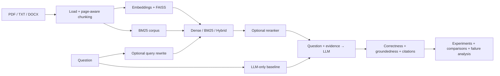

<div align="center">


**Compare retrieval and generation pipelines with reproducible experiments, evidence-aware metrics, and failure analysis.**


</div>

## Overview

RAGeval is a research-oriented framework for evaluating Retrieval-Augmented Generation systems. It measures more than whether an answer sounds plausible: it checks whether retrieval surfaced useful evidence, whether generated answers are correct and grounded, how the system handles unanswerable questions, and what each configuration costs in latency and token usage.

The framework compares LLM-only, dense-vector, BM25, hybrid, reranked, and query-rewritten pipelines. It includes document ingestion, experiment tracking, comparison tools, deterministic failure analysis, a FastAPI backend, and a Next.js research dashboard.

> **Evidence boundary:** the retained real study compares **Dense, BM25, and Hybrid** retrieval on a controlled **10-question subset** of a 30-question benchmark. LLM-only, reranking, query rewriting, and broader sweeps are implemented and tested capabilities—not additional real-study results.

## Key Features

- **Document ingestion:** PDF, UTF-8 TXT, and DOCX loading with source and page metadata.
- **Retrieval strategies:** dense FAISS search, BM25, and hybrid Reciprocal Rank Fusion.
- **Optional enhancements:** cross-encoder reranking and query rewriting.
- **Generation baselines:** LLM-only and retrieval-augmented generation.
- **Provider support:** native Gemini and OpenAI-compatible endpoints.
- **Evaluation:** retrieval quality, correctness, groundedness, citations, refusal behavior, latency, and usage.
- **Research workflow:** typed benchmarks, reproducible experiment records, checkpoints, comparisons, and sweeps.
- **Diagnostics:** strict judge contracts and deterministic failure classification.
- **Interfaces:** FastAPI API, Next.js dashboard, and Dockerized backend.

## Evaluation Scope

### Retrieval

- **Hit Recall@K:** `1` when at least one relevant chunk appears in the first `K` results.
- **MRR:** reciprocal rank of the first relevant chunk, averaged across applicable questions.
- Items without relevance labels are excluded with explicit counts.

### Generation

- Answer correctness against the reference answer.
- Groundedness against retrieved evidence.
- Citation metadata validity and semantic support.
- Unsupported-claim, hallucination, and refusal behavior.
- Strict parsing that rejects malformed judge output.

### Efficiency

- Monotonic elapsed latency.
- Prompt, completion, and total token usage.
- Monetary cost only when reliable provider metadata is available; unavailable values remain `null`.

For LLM-only runs, retrieval and evidence metrics are **not applicable** and remain `null`, never zero. Evidence judges are skipped, and substantive answers are marked `unassessed_answer` instead of receiving an invented groundedness result.

## Architecture



Provider transport is isolated behind `LLMService`. Gemini uses native `generateContent`; OpenAI-compatible providers use non-streaming chat completions. Runtime startup is opt-in, indexes are built once per worker, and reranker weights load only when reranking is requested.

## Project Structure

```text
RagEval/
├── backend/
│   ├── app/
│   │   ├── api/                 # Query, document, experiment, and result routes
│   │   ├── embeddings/          # Embedding service
│   │   ├── ingestion/           # Loaders and chunking
│   │   ├── retrieval/           # Dense, BM25, hybrid, and reranking
│   │   ├── generation/          # LLM transport, prompts, and RAG pipeline
│   │   ├── evaluation/          # Metrics, judges, and failure analysis
│   │   └── experiments/         # Runs, comparisons, checkpoints, and sweeps
│   ├── data/                    # Corpus, benchmarks, and processed evidence
│   ├── results/                 # Experiments, comparisons, and final summaries
│   └── tests/                   # Mocked and offline backend tests
├── frontend/
│   ├── app/                     # Next.js routes
│   ├── components/              # Query and research workspace
│   ├── lib/                     # Backend API client
│   └── tests/                   # Frontend request/render checks
├── .env.example
└── README.md
```

## Installation

### Prerequisites

- Python 3.11
- Node.js 22.13 or newer
- A Gemini key or an OpenAI-compatible provider
- Optional: Docker Desktop or Docker Engine

Commands below use Windows PowerShell.

### Backend Setup

```powershell
git clone https://github.com/FarisDosani/RagEval.git
cd RagEval

py -3.11 -m venv venv
.\venv\Scripts\python.exe -m pip install -r backend\requirements.txt
Copy-Item .env.example .env
```

Configure a provider in `.env`:

```dotenv
LLM_PROVIDER=gemini
GEMINI_MODEL=gemini-3.5-flash-lite
GEMINI_API_KEY=your-local-key
```

For an OpenAI-compatible service, set `LLM_PROVIDER=openai`, `LLM_BASE_URL`, `LLM_API_KEY`, and `LLM_MODEL`. Process environment variables override file values. Never commit real credentials.

Start the backend:

```powershell
cd backend
..\venv\Scripts\Activate.ps1
$env:RAGEVAL_AUTO_INIT = "true"
uvicorn app.main:app --reload --host 0.0.0.0 --port 8000
```

Useful endpoints:

- API: `http://localhost:8000`
- Health: `http://localhost:8000/health`
- OpenAPI documentation: `http://localhost:8000/docs`

`RAGEVAL_CORPUS_PATH` defaults to `data/corpus/Week # 02 Slides.pdf` relative to `backend/`. `RAGEVAL_MAX_UPLOAD_BYTES` defaults to 10 MiB. Export runtime settings in the process environment before starting Uvicorn.

### Frontend Setup

In a second terminal:

```powershell
cd RagEval\frontend
npm ci
Copy-Item .env.example .env.local
npm run dev
```

Open `http://localhost:3000`. `NEXT_PUBLIC_API_BASE_URL` defaults to `http://localhost:8000`; provider credentials must never be placed in public frontend variables.

## Usage

1. Open the Query workspace and upload a PDF, TXT, or DOCX document.
2. Select Dense, BM25, Hybrid, or LLM Only.
3. Choose `top_k` where retrieval applies and submit a question.
4. Inspect the answer, ranked evidence, source metadata, citations, latency, and usage.
5. Run a benchmark from Experiments with explicit model and strategy settings.
6. Compare saved runs against the same benchmark.
7. Open Failure Analysis for a saved experiment ID.

LLM Only sends the question directly to the configured model. It does not retrieve evidence, ignores `top_k`, and returns empty evidence/citation collections. This creates a baseline for measuring whether retrieval improves the system.

### Document API

- `POST /documents/upload?filename=notes.txt` accepts raw bytes with `Content-Type: application/octet-stream`.
- `GET /documents` returns current indexed document metadata.
- Unsupported, empty, malformed, or text-empty uploads return `400`.
- Oversized uploads return `413`.

Uploads are added to the current in-memory corpus. Index rebuilds are published atomically, so failed uploads preserve the previous snapshot. Uploaded files remain on disk but are not automatically re-indexed after restart.

## Retained Research Study

The versioned corpus is a 45-page slide deck covering technology trends, power and energy, and dependability. Extraction produced 41 units, 2,156 words, and 41 baseline chunks. The benchmark contains 30 questions: 24 answerable and 6 unanswerable.

The final comparison uses a fixed 10-question subset—8 answerable and 2 unanswerable—with native Gemini `gemini-3.5-flash-lite` and `top_k=5`.

### Recorded Results

| Strategy | Recall@5 | MRR | Correctness | Groundedness | Questions with detected failures |
|---|---:|---:|---:|---:|---:|
| Dense | 1.00 | 0.7604 | 0.625 | 0.90 | 3 |
| BM25 | 1.00 | 0.875 | 0.750 | 1.00 | 2 |
| Hybrid | 1.00 | 0.875 | 0.750 | 1.00 | 2 |

The separate retrieval-only Hybrid top-k study made no Gemini calls:

- `k=1`: hit Recall `0.75`, truncated-ranking MRR `0.75`.
- `k=3`: hit Recall `1.00`, truncated-ranking MRR `0.875`.
- `k=5`: hit Recall `1.00`, truncated-ranking MRR `0.875`.

These are small-sample observations, not a general ranking of retrieval strategies. Hit Recall measures whether at least one relevant result was found, not whether every piece of evidence required for a multi-hop answer was retrieved.

<details>
<summary><strong>Evidence and reproducibility artifacts</strong></summary>

- [Final summary](backend/results/final/ca_small_gemini_final_summary.json)
- [30-question benchmark](backend/data/benchmarks/ca_small_benchmark.json)
- [Fixed evaluation subset](backend/data/processed/phase25/evaluation_subset.json)
- [Main comparison](backend/results/comparisons/29261415-a8ea-4828-8128-3154ca5aaafa.json)
- [Retrieval-only top-k study](backend/results/final/retrieval_top_k.json)
- [Usage ledger](backend/results/final/usage_ledger.json)

The retained ledger records 158 successful calls from 159 attempts and 168,587 tokens across generation, diagnostics, and judges. Cost remains `null` because reliable provider cost metadata was unavailable.

Main experiment IDs:

- Dense: `4dca9879-d7e1-4bdf-ac30-4dd08ccb7fc6`
- BM25: `0f1cf518-9c3b-4ebb-a584-737caeea0e43`
- Hybrid: `64a83121-34c5-4d49-a0b2-3c729aabd98d`

</details>

## Failure Analysis

Failure analysis classifies retrieval misses, low-rank evidence, incorrect or partial answers, ungrounded generation, citation failures, hallucination, incorrect refusal, and failed refusal. Multiple categories may apply to one question.

Counts retain explicit denominators. Missing evidence never invents rank information, LLM-only runs skip evidence-based judgments, and a failure-free result means only that no configured detector found a failure.

## Testing

The documented verified baseline is **609 backend tests** and **3 frontend checks**, with frontend lint and production build passing. Provider and model calls are mocked in the test suite.

```powershell
cd backend
..\venv\Scripts\python.exe -m pytest

cd ..\frontend
node --test tests/llm-only.test.mjs
npm run lint
npm run build
```

Dependencies are pinned in `backend/requirements.txt` and `frontend/package-lock.json`.

## Docker

Build the backend from the repository root:

```powershell
docker build -t rageval-backend ./backend
docker run --rm --env-file .env -p 8000:8000 rageval-backend
```

The basic container command supports health and API documentation. Auto-initialization also requires access to the corpus and, when applicable, downloadable or cached embedding weights. The existing README history documents bind mounts for persistent data and results when running the complete local research demo.

## Limitations

- Indexes are session-local and reset on restart.
- The demo has no authentication or production deployment hardening.
- The real study uses a small corpus and a 10-question evaluation subset.
- Generation and judging use the same model in the retained study.
- Text extraction does not perform OCR or capture image-only diagrams and equations.
- Source units are shorter than the tested chunk sizes, so no meaningful chunk-size sensitivity claim is made.
- The real final comparison covers Dense, BM25, and Hybrid only.
- Monetary cost is unavailable unless the provider supplies reliable metadata.

---

<div align="center">

Designed for transparent, evidence-aware comparison of RAG pipelines—not leaderboard claims without context.

<a href="https://github.com/FarisDosani/RagEval">View repository</a> · <a href="https://github.com/FarisDosani/RagEval/issues">Report an issue</a>


</div>
